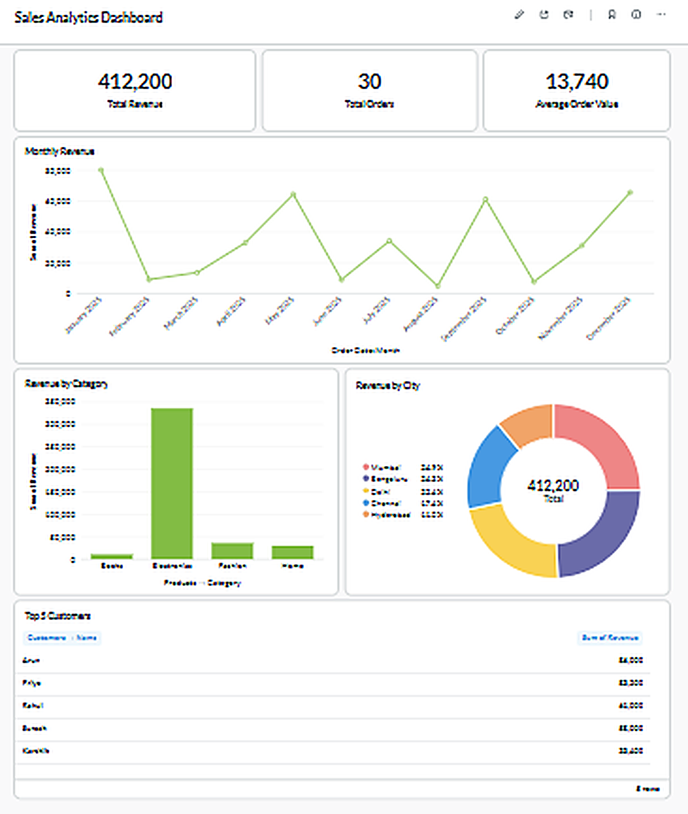
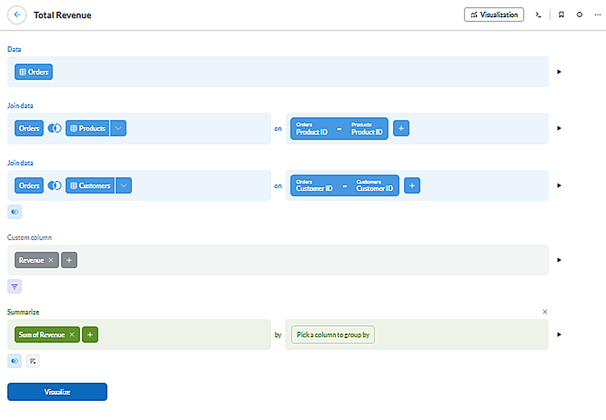
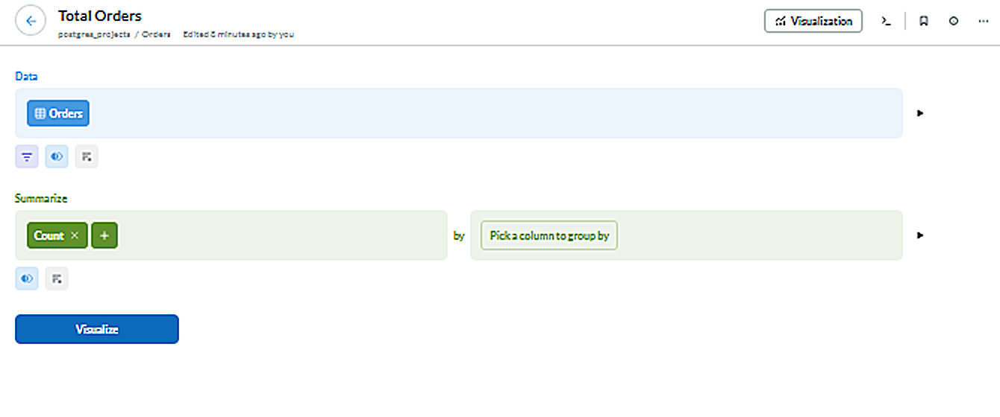
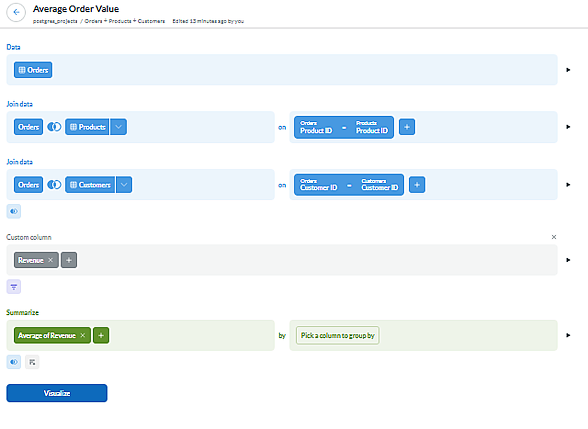
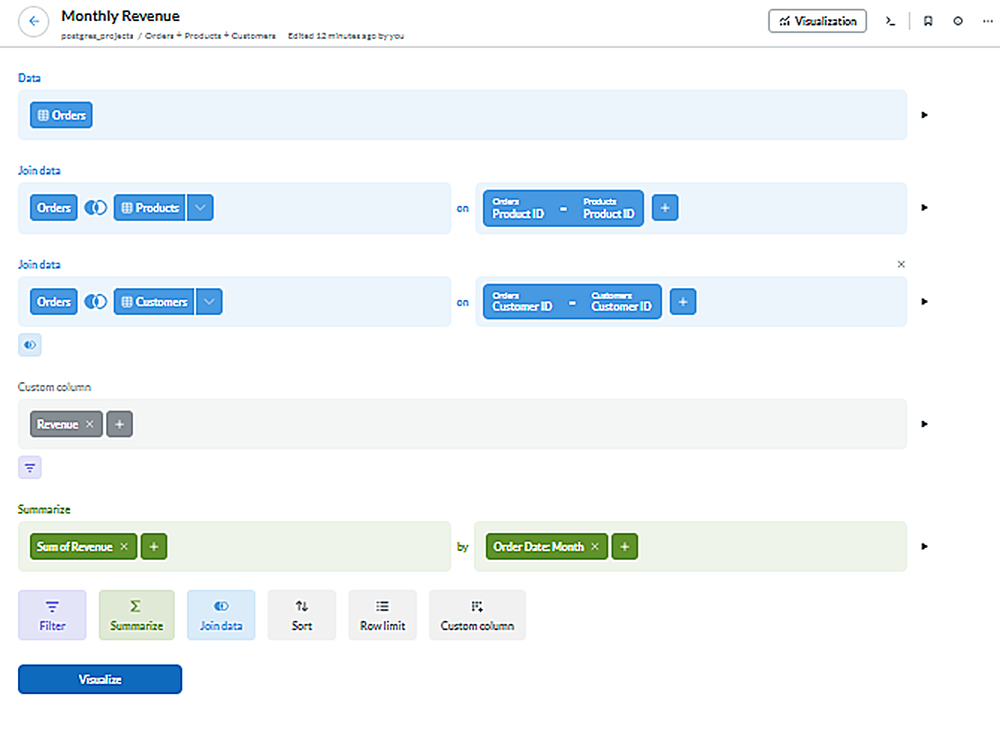
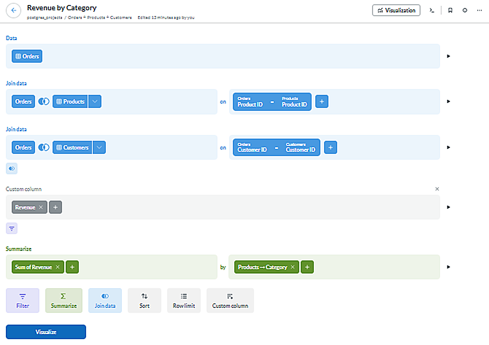
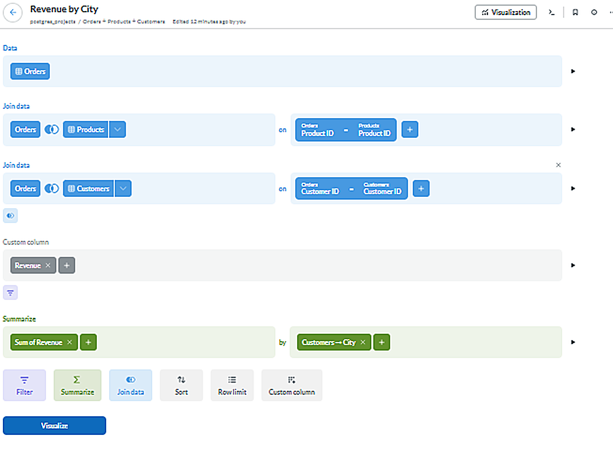
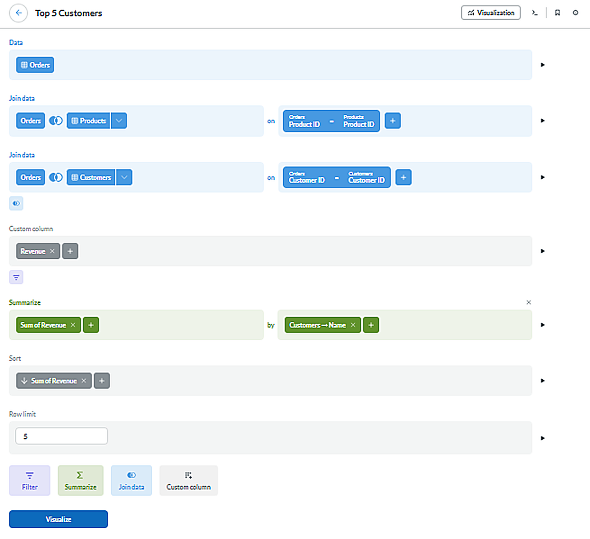

# Sales Analytics Dashboard (PostgreSQL + Metabase)

A sales analytics project where I designed a PostgreSQL database in Navicat and built an interactive dashboard in Metabase using SQL joins, aggregation, and group-by.

## Tools Used
- PostgreSQL
- Navicat
- Metabase
- SQL

## Database Schema
- **customers** (customer_id, name, city)
- **products** (product_id, product_name, category, price)
- **orders** (order_id, customer_id, product_id, quantity, order_date)

Sample data: 10 customers, 10 products, 30 orders. See `schema_and_data.sql`.

## Table Roles
- **Orders** is the main (fact) table, so every question starts here.
- **Products** supplies `price` and `category`.
- **Customers** supplies `name` and `city`.

## Joins Used

| Join | Match Columns |
|------|---------------|
| Orders → Products | `Orders.product_id` = `Products.product_id` |
| Orders → Customers | `Orders.customer_id` = `Customers.customer_id` |

## Custom Column (Revenue)

Used in every question that joins Products:

```
[Quantity] * [Products → Price]
```

## How Each Dashboard Question Is Built

| # | Question | Start From Table | Join With | Custom Column | Summarize | Group By | Visualization |
|---|----------|------------------|-----------|---------------|-----------|----------|---------------|
| 1 | Total Revenue | Orders | Products | Revenue | Sum of Revenue | None | Number |
| 2 | Total Orders | Orders | None needed | None | Count of rows | None | Number |
| 3 | Average Order Value | Orders | Products | Revenue | Average of Revenue | None | Number |
| 4 | Revenue by Category | Orders | Products | Revenue | Sum of Revenue | Products → Category | Bar |
| 5 | Monthly Revenue | Orders | Products | Revenue | Sum of Revenue | Orders → Order Date: Month | Line |
| 6 | Revenue by City | Orders | Products and Customers | Revenue | Sum of Revenue | Customers → City | Donut |
| 7 | Top 5 Customers | Orders | Products and Customers | Revenue | Sum of Revenue | Customers → Name | Table |

Extra steps for **Top 5 Customers**: sort by Sum of Revenue (descending) and set the row limit to 5.

## Dashboard


## Question Setups (Screenshots)

**1. Total Revenue**


**2. Total Orders**


**3. Average Order Value**


**4. Monthly Revenue**


**5. Revenue by Category**


**6. Revenue by City**


**7. Top 5 Customers**


## Key Insights
- Total revenue is 412,200 across 30 orders, with an average order value of 13,740.
- Electronics is the top category by a large margin.
- Revenue is spread fairly evenly across the five cities, led by Mumbai and Bengaluru.

## How to Run
1. Run `schema_and_data.sql` in PostgreSQL (Navicat).
2. Connect the database to Metabase (Admin → Databases → Add database).
3. Create the questions as described in the table above and add them to a dashboard.